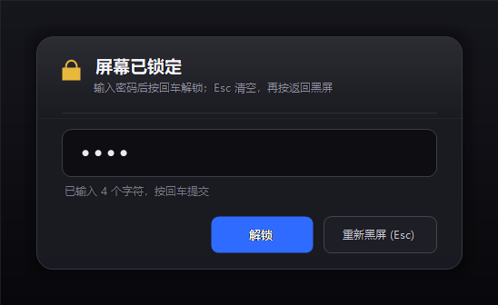

# BlackScreenLock（黑屏锁）

一个**免安装的单文件** Windows 小工具：按快捷键让屏幕变黑，物理键鼠被临时屏蔽；动一下鼠标或按任意键，画面立刻变成**磨砂玻璃 + 密码卡片**，输入密码即可恢复。
**全程不锁屏、不切会话、不抢焦点、不关显示器、不遮挡截图**，正在跑的 UI Automation 自动化与截屏任务完全不受影响。

- 产物：`dist/BlackScreenLock.exe`（约 62 KB，无第三方依赖）
- 运行环境：Windows 10 / 11 自带的 .NET Framework 4.x，双击即用，无需安装
- 配置文件与日志写在 exe 同目录（目录不可写时自动落到 `%APPDATA%\BlackScreenLock`）

---

## 快速开始

免安装单文件，到 [Releases](https://github.com/huimaosandu/BlackScreenLock/releases/latest) 下载 `BlackScreenLock.exe`（约 64 KB，依赖系统自带的 .NET Framework 4.x，无需安装任何运行时）。

直链：`https://github.com/huimaosandu/BlackScreenLock/releases/latest/download/BlackScreenLock.exe`（仓库源码树里不再存放 exe，`dist/` 是本地构建输出）

1. 双击下载到的 `BlackScreenLock.exe`。**首次运行只要求设置解锁密码**（4~64 位，只能用英文字母/数字/英文符号），窗口底部有「确认」「取消」两个按钮；设置完自动进入托盘。
2. 按 `Ctrl + Alt + L`（或托盘菜单「立即锁屏」）→ 屏幕立刻变成纯黑。
3. 解锁：**动一下鼠标或按任意键**，画面立即变成磨砂玻璃并弹出密码卡片。
   - 输入密码，按 `回车` 或点「解锁」
   - 按 `Esc` 清空，按 `Backspace` 删除最后一位
   - 点「重新黑屏」立即回到纯黑；15 秒无操作也会自动回到纯黑
4. 之后想改密码，必须在“设置密码”窗口里**先输入原密码**，校验通过才能改。

托盘图标在任务栏通知区域（Windows 11 默认收在“显示隐藏的图标”里，可拖到常驻区）。右键即可操作全部功能。

密码卡片长这样（由 `--selftest` 生成 `dist/ui-preview.png`，仅为布局示意图）：



---

## 锁屏后的两种形态

| 形态 | 触发 | 屏幕 | 键鼠 | 鼠标穿透 |
| --- | --- | --- | --- | --- |
| 纯黑（Idle） | 刚锁屏 / 点「重新黑屏」/ 15 秒无操作 | 全屏纯黑遮罩 | 物理输入全部吞掉，注入输入放行 | 开启（自动化的坐标点击穿过遮罩） |
| 磨砂（Prompt） | 动鼠标 / 按任意键 | 磨砂玻璃遮罩（抓当前桌面做模糊）+ 密码卡片 | 物理键盘仍由程序接管；物理鼠标放行以便点按钮 | 关闭（点击落在卡片按钮上） |

两种形态是**同一个全屏窗口**的不同外观，键盘输入始终不经过控件，而是由全局钩子喂给内部缓冲再自绘成圆点 —— 所以遮罩从不抢焦点，背后自动化的前台窗口不会被踢掉。

---

## 托盘右键菜单

| 菜单项 | 说明 |
| --- | --- |
| 立即锁屏 | 右侧直接显示当前热键，如 `Ctrl + Alt + L` |
| 开机自动启动 | 勾选即写入当前用户启动项，开机后静默驻留托盘，不弹任何窗口 |
| 保持系统唤醒 | **默认勾选**。勾选时只要程序在托盘运行，Windows 不会空闲睡眠/休眠，后台自动化不会被打断；取消勾选即恢复系统默认睡眠策略 |
| 设置密码... | 首次无需原密码；已有密码时必须验证原密码 |
| 编辑快捷键... | 在输入框里直接按下目标组合键，立即生效并写入配置 |
| 选项... | 开机自启、密码错误提示音、保持系统唤醒（同样默认勾选）、配置文件位置 |
| 使用说明 | 快捷键/解锁方式/原理/边界说明 |
| 退出 | 若处于锁定状态会先恢复屏幕再退出 |

快捷键规则：至少包含 `Ctrl` 或 `Alt`；`F1 ~ F24` 可以单独使用；回车 / 退格 / Esc / Tab / 空格不能作为热键。
若新组合已被其它程序占用，会提示失败并保留原快捷键。

---

## 为什么不影响 UIA 与截图

这是本工具与“Win + L 锁屏”“普通全屏黑色遮罩”类工具的根本区别。锁屏只有四件事：

1. 安装 `WH_KEYBOARD_LL` / `WH_MOUSE_LL` 低级钩子，吞掉**物理**键鼠（带 `LLKHF_INJECTED` / `LLMHF_INJECTED` 标记的注入输入一律放行）；
2. 显示一个覆盖虚拟屏幕的遮罩窗口，调用 `SetWindowDisplayAffinity(hwnd, WDA_EXCLUDEFROMCAPTURE)`；
3. 遮罩使用 `WS_EX_NOACTIVATE` + `WS_EX_TOOLWINDOW` + `ShowInTaskbar=false`，永不激活、不抢前台；
4. 用 `SetThreadExecutionState(ES_CONTINUOUS | ES_SYSTEM_REQUIRED)` 阻止系统睡眠。

其中第 4 条由「保持系统唤醒」选项控制，**默认开启**：程序一启动就申请，非锁屏期间同样有效，所以后台自动化不会因为机器空闲睡眠而中断。锁屏期间会额外加上 `ES_DISPLAY_REQUIRED`，避免电源计划在锁定中途关屏（关屏再点亮会让 DWM 重建合成表面）；解锁后回到只看选项的状态。显示器平时是否关闭仍由 Windows 电源计划决定，想让屏幕也常亮请把电源计划改成“从不关闭显示器”。

关键点：

- **不调用 `LockWorkStation`，不切换用户会话**。桌面会话保持解锁，UIA 元素树、`AutomationElement` 遍历、各类 Pattern 调用全部照常。
- **遮罩对截屏不可见**。`WDA_EXCLUDEFROMCAPTURE`（Win10 2004+）让合成器在采样屏幕时排除这个窗口，`BitBlt` / `CopyFromScreen` / `PrintWindow` / 图形捕获拿到的仍是真实桌面画面。
- **磨砂背景来自“被排除后的桌面”**。唤醒时程序自己抓一张桌面做模糊，因为抓屏接口已经被排除遮罩，抓到的是干净桌面，所以磨砂效果不会污染任何截图。
- **遮罩不抢焦点**，自动化的前台窗口判定不受影响。
- **纯黑形态鼠标穿透**（`WS_EX_TRANSPARENT`），注入的坐标点击直接落到真实目标窗口；只有你主动唤醒磨砂界面时才短暂接管鼠标，15 秒后自动恢复穿透。
- **锁屏不关显示器**：关屏再点亮会让 DWM 重建合成表面，遮罩会丢失一瞬（人眼看到桌面闪一下、截屏也会抓到遮罩）。所以这里用纯黑遮罩代替关屏，显示器背光保持点亮，视觉上同样是黑屏。代价是背光耗电，换来的是唤醒瞬间无闪屏、截图全程干净。

### 解锁后不会留下“卡住”的按键

低级钩子吞掉的只是事件，系统对修饰键的“按下/弹起”状态是自己维护的。按 `Ctrl+Alt+L` 锁屏时，Ctrl 与 Alt 的**按下**已经先到了系统（热键要触发），而它们的**弹起**发生在钩子生效之后、被吞掉了；点「解锁」按钮时同理，左键的 `up` 随遮罩一起消失。结果是系统一直认为这四个键按着 —— 解锁后打字全变成快捷键、鼠标点击变成 Ctrl+点击（看起来点不开）。

解锁流程因此固定为三步，顺序不能颠倒：

1. `Uninstall()` 先关拦截开关（`_active = false`）再摘两个钩子，失败重试 3 次并记日志。即使三次都失败，回调也会直接 `CallNextHookEx` 放行，**不会再吞键**；
2. `HideOverlay()` 隐藏遮罩；
3. `ReleaseStuckInput()` 用 `keybd_event` / `mouse_event` 给 Ctrl、Alt、Shift、Win 左右键、回车、空格、Tab、Esc、退格以及鼠标左右中键各补一个“弹起”。注入事件带 `INJECTED` 标记，不会被自己的钩子拦，物理上没按也补一次是无害的空操作。

程序退出（`Dispose`）时同样执行卸载 + 补弹起，避免从托盘退出后残留状态。

### 逐时点实测（本机 Windows 11，1920×1080）

| 指标 | 锁屏前 | 纯黑锁屏中 | 磨砂 1s | 磨砂 3s | 磨砂 6s | 磨砂 10s | 解锁后 |
| --- | --- | --- | --- | --- | --- | --- | --- |
| 截屏平均亮度 | 246.11 | 246.32 | 246.33 | 246.33 | 246.32 | 246.33 | 245.84 |
| 中心 240×240 亮度 | 240.01 | 240.01 | 240.01 | 240.01 | 240.01 | 240.01 | 240.01 |
| UIA 顶层窗口数 | 18 | 19 | 19 | 19 | 19 | 19 | 20 |

磨砂界面显示的第 1、3、6、10 秒，截屏亮度与中心像素全部与基线一致 —— 遮罩在任何时刻都没有进入截图。
UIA 顶层窗口数只多出 1 个，就是遮罩窗口本身（窗口标题固定为 `BlackScreenLock.Overlay`）。如果你的自动化脚本会遍历顶层窗口，按这个标题或类名 `WindowsForms10.Window.*` 过滤即可。

---

## 边界与限制（务必知道）

- **`Ctrl + Alt + Del` 拦不住**：这是系统安全序列，任何用户态程序都无法拦截。按下会进入安全桌面。同理 UAC 提权弹窗也会切到安全桌面。
- **磨砂是“看得见的锁屏”**：能看到磨砂后的桌面轮廓，代价是身后的人也能看到画面轮廓。纯黑形态（Idle）才是完全防窥的。
- **显示器背光保持点亮**：这是为截图稳定性做的取舍（见上文）。视觉上仍是全黑；如果长时间锁屏且在意耗电，请手动按显示器电源键。
- **密码规则**：只能用 ASCII 可打印字符（英文字母、数字、英文符号），因为接管键盘时打不出中文。解锁时**字母不区分大小写**，CapsLock 开或关都能解开。
- **密码输错**：卡片上显示“密码错误，请重新输入”，同时播放提示音（可在选项中关闭）；日志只记“密码错误”，不记内容。
- **远程桌面（RDP）会话**：遮罩覆盖的是虚拟屏幕，RDP 客户端里也能看到；键鼠拦截与截图排除照常生效。
- **热键是系统级占用**：锁定后按 `Ctrl + Alt + L` 会再触发一次锁屏（已锁定则忽略）。如果和你的工具冲突，请在“编辑快捷键”里换掉。
- **多显示器**：一个遮罩横跨整个虚拟屏幕，密码卡片固定在主显示器中央。Windows 10 2004 之前的系统不支持按窗口排除截屏，此时遮罩会出现在截图里（`--selftest` 的「遮罩截图排除」一项会报失败）。
- **万一解锁后还有键“粘住”**：先看是否触发了 Windows「粘滞键」（连按 5 次 Shift 会开启，属于系统功能，与本工具无关；在「设置 → 辅助功能 → 键盘」关掉即可）。也可以直接再按一次那个卡住的键（Ctrl / Alt / Shift / Win）让它配对弹起。程序每次解锁都会自动补一次弹起，正常情况不需要手动处理。
- 个别显卡/驱动在全屏遮罩下可能出现光标残影，属于驱动行为，与工具无关。

---

## 忘了密码 / 解不开了

1. 在本机另开一个命令行通道（远程执行、计划任务、自动化脚本均可）运行
   `dist\BlackScreenLock.exe --unlock`，会跳过密码直接解锁；
2. 或者按 `Ctrl + Alt + Del` 进入安全桌面，从安全桌面打开任务管理器结束 `BlackScreenLock.exe` 进程；
3. 进程结束后钩子与遮罩自动释放，屏幕立即恢复。

之后删掉 `dist\BlackScreenLock.cfg` 再启动程序，会回到首次运行、重新设置密码。

`--unlock` 的存在意味着“能在本机执行命令的人都能解锁”——它防的是看屏幕的人，不是本机操作者。

---

## 命令行

| 参数 | 作用 |
| --- | --- |
| （无） | 正常启动到托盘 |
| `--tray` | 同上，供开机自启动使用（静默、不弹窗） |
| `--lock` | 若已在运行，让它立即锁屏；未运行则启动并锁屏 |
| `--unlock` | 若已在运行，跳过密码强制解锁（本机应急用） |
| `--selftest` | 跑一遍非破坏性自检，结果写到 `dist/selftest.log`，并导出 `dist/ui-preview.png` |

---

## 配置文件

`dist/BlackScreenLock.cfg`（纯文本，便于排查）：

```
Salt=<hex>            # PBKDF2 随机盐
Hash=<hex>            # PBKDF2-SHA1，100000 次迭代，32 字节
SoundOnError=1        # 密码错误提示音
AlwaysAwake=1         # 保持系统唤醒，默认 1；0 = 恢复系统睡眠策略
KeepDisplayOff=1      # 历史字段，当前版本不再使用（锁屏已改为纯黑遮罩）
HotKeyModifiers=3     # 2=Ctrl 1=Alt 4=Shift，3 即 Ctrl+Alt
HotKeyVk=76           # 76 = 'L'
```

密码只保存派生结果，删掉本文件即回到“首次运行”，需要重新设置密码。

日志：`dist/logs/yyyy-MM-dd.log`，单文件超过 2MB 自动清空重写。

---

## 构建

```powershell
cd E:\个人项目\BlackScreenLock
.\build.ps1              # 仅编译
.\build.ps1 -RunSelfTest # 编译 + 自检
```

编译器用系统自带的 `C:\Windows\Microsoft.NET\Framework64\v4.0.30319\csc.exe`，不下载任何 NuGet 包、不需要 dotnet SDK。
脚本会自动给 `src/*.cs` 补 UTF-8 BOM，保证 csc 正确解析中文。

---

## 目录结构

```
BlackScreenLock/
├─ build.ps1                  构建脚本（csc 单文件编译）
├─ src/
│  ├─ Program.cs              入口、参数、单实例
│  ├─ App.cs                  托盘、菜单、热键调度、锁屏流程
│  ├─ LockController.cs       锁屏状态机（纯黑/磨砂两态）、密码缓冲与校验
│  ├─ LockOverlayForm.cs      全屏遮罩：自绘磨砂卡片、截图排除、鼠标穿透切换
│  ├─ ScreenBlur.cs           抓桌面 -> 缩小 -> 箱式模糊 -> 放大，生成磨砂背景
│  ├─ InputHook.cs            低级键鼠钩子（只拦物理输入）
│  ├─ DisplayControl.cs       DPMS 亮屏、执行状态
│  ├─ MessageWindow.cs        隐藏消息窗口（热键/电源广播/按键与鼠标转发）
│  ├─ Config.cs               配置读写、PBKDF2 密码
│  ├─ AutoStart.cs            HKCU Run 启动项
│  ├─ KeyMapper.cs            虚拟键↔字符、热键文本
│  ├─ IconFactory.cs          代码绘制托盘图标（无外部 .ico）
│  ├─ ToastForm.cs            解锁后的轻提示
│  ├─ PasswordDialog.cs       设置/修改密码（改密码验原密码）
│  ├─ HotkeyDialog.cs         快捷键捕获与校验
│  ├─ OptionsDialog.cs        选项与配置路径
│  ├─ SelfTest.cs             自检
│  ├─ Log.cs                  日志
│  └─ NativeMethods.cs        Win32 API 声明
└─ dist/                      编译产物与配置（BlackScreenLock.exe）
```

---

## 已验证（`--selftest` 16 项 + 端到端脚本）

- 密码 PBKDF2 派生、正码通过、误码拒绝
- 锁屏输入链路：字符缓冲、退格、回车提交、校验
- 遮罩截图排除（`SetWindowDisplayAffinity` 返回成功）
- 磨砂界面预览导出（`dist/ui-preview.png`）
- 键盘映射、托盘图标、低级键鼠钩子安装/卸载
- 隐藏消息窗口、`Ctrl + Alt + L` 全局热键、显示器电源通知
- 保持系统唤醒执行状态的开 / 关调用
- 开机自启动注册表写入 / 读回 / 删除
- 单独探针验证：改窗口样式、改透明度、强制重绘、重设/切换排除标记，遮罩在截图中均保持不可见
- 端到端：锁屏 → 纯黑 → 唤醒磨砂（1/3/6/10 秒逐点采样均与基线一致）→ 输入密码 → 解锁成功
- 解锁清理链路：钩子卸载失败时自动退化为“放行模式”（代码路径已审阅；`--selftest` 的钩子安装/卸载项通过）
